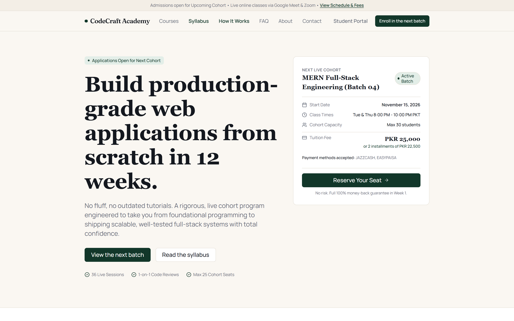
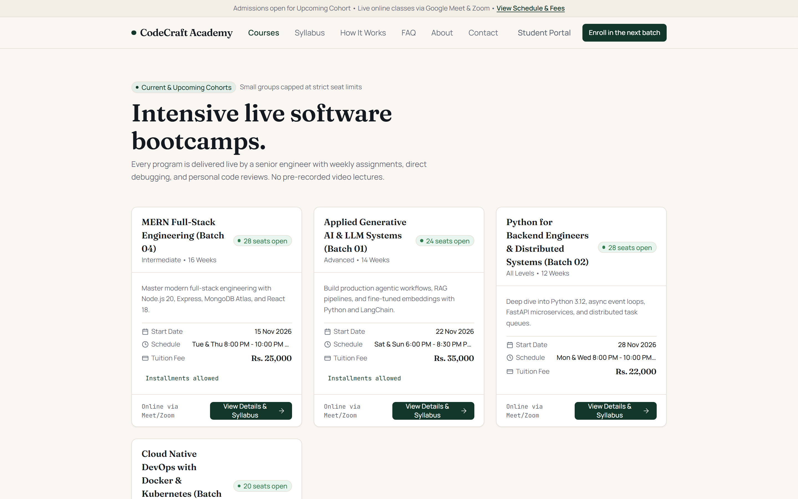
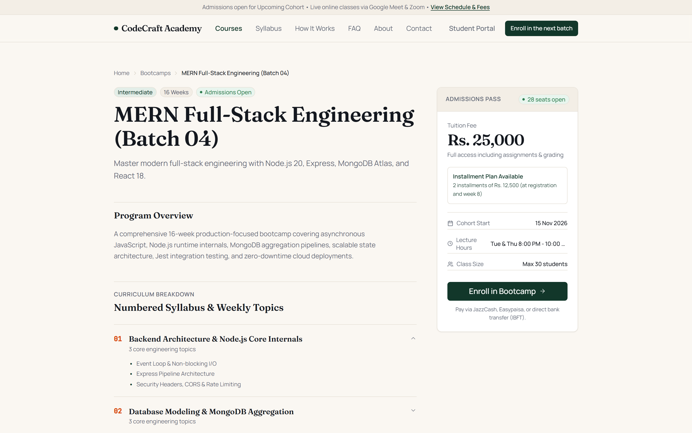
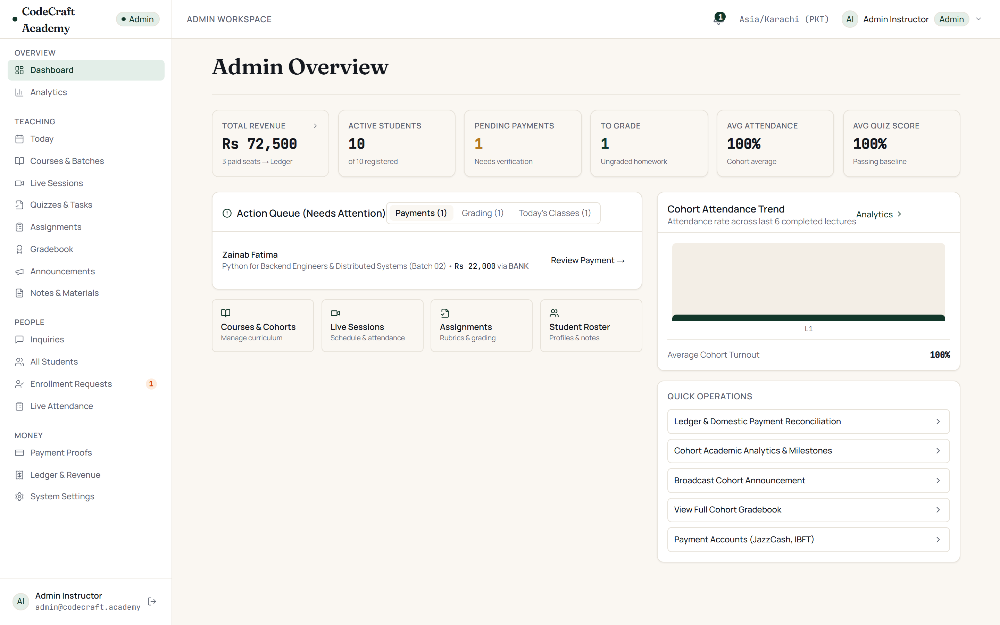
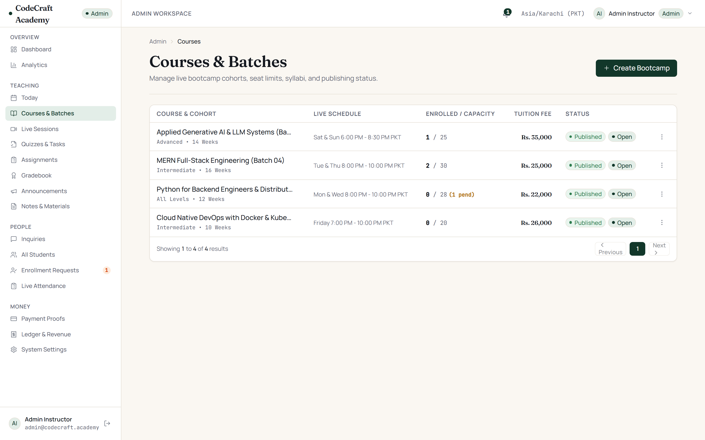
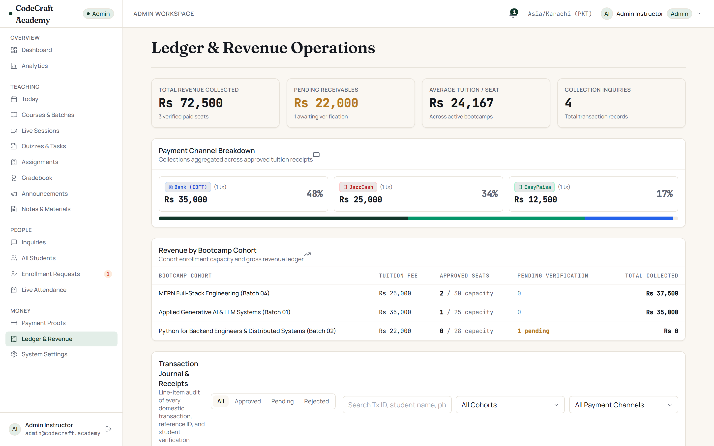
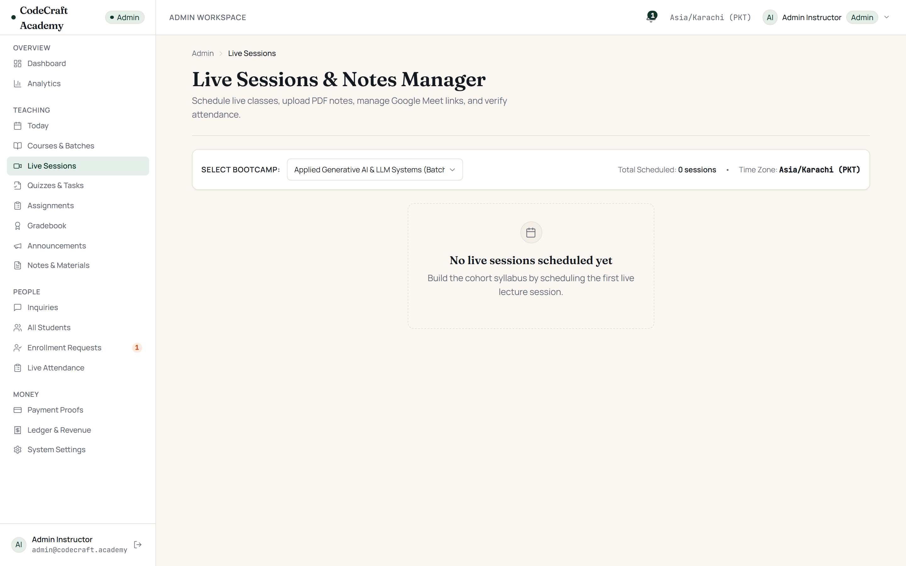
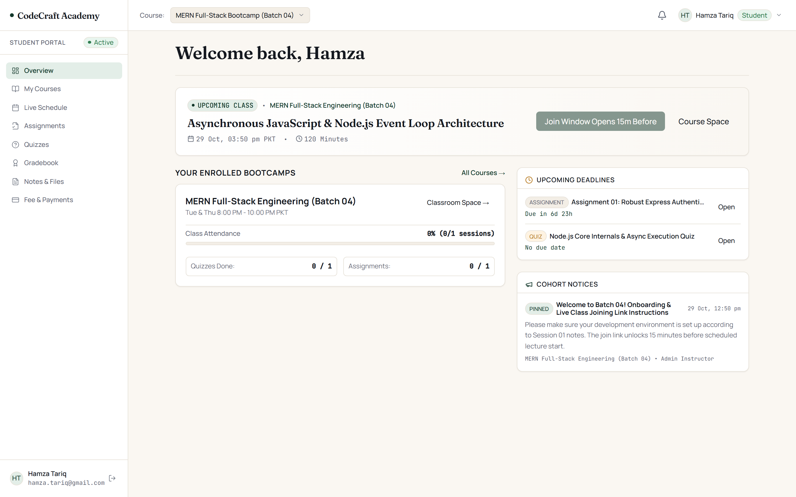
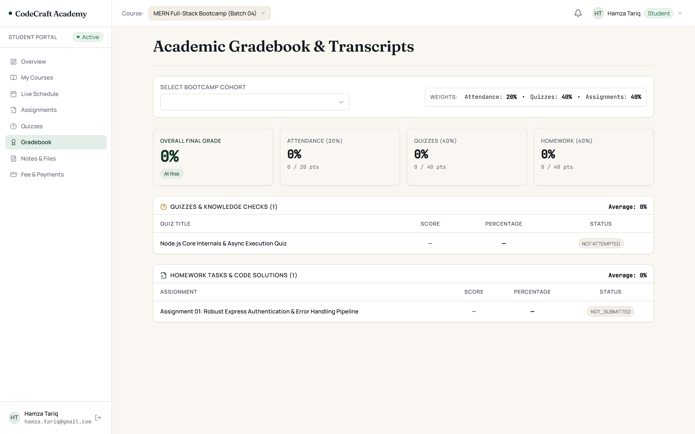
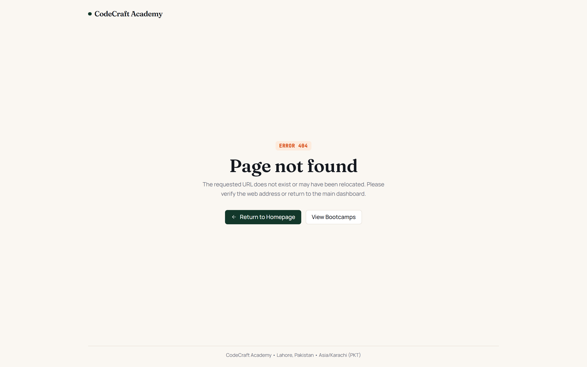

# CodeCraft Academy — Bootcamp Learning Management System (LMS)

[](https://react.dev/)
[](https://nodejs.org/)
[](https://www.mongodb.com/)
[](https://tailwindcss.com/)
[](https://playwright.dev/)

A full-stack, cohort-based Learning Management System engineered specifically for intensive live software engineering bootcamps (MERN Full-Stack, Generative AI & LLMs, Python Backend Systems, and Cloud DevOps).

Unlike typical video-hosting platforms, CodeCraft Academy is tailored for **live instructor-led bootcamps** conducted via Google Meet or Zoom. It manages the complete end-to-end operational lifecycle: marketing catalogs, admissions, manual PKR payment verification (JazzCash, EasyPaisa, SadaBiz, Bank Wire), automated meeting join window enforcement, attendance, lecture notes, anti-cheat quizzes, rubric-graded assignments, student gradebooks, and cohort revenue analytics.

---

## Visual Showcase

### 1. Public Marketing & Course Discovery

#### Landing Page & Active Cohort
Live hero showcasing the current active cohort, countdown timer, tuition details, and direct enrollment entry.



#### Multi-Track Course Catalog
Full engineering catalog with course levels, batch numbers, durations, seat caps, and transparent PKR tuition fees.



#### Detailed Syllabus & Curriculum Deep-Dive
Comprehensive course syllabus broken down by weeks, topics, outcomes, and prerequisites.



---

### 2. Instructor & Admin Operations Workspace

#### Executive Admin Dashboard
High-level operational overview tracking total students, active cohort enrollments, total revenue in PKR, and quick actions.



#### Course & Cohort Management
Create, edit, and publish bootcamps with configurable installment plans, seat limits, and enrollment toggles.



#### PKR Operations Ledger & Payment Verification
Manual payment verification pipeline for Pakistani banking methods (JazzCash, EasyPaisa, SadaBiz, Bank Wire) with status badges and transaction auditing.



#### Live Lecture Scheduling & Join Window Access Control
Class schedules with Google Meet integration and strict time-based join window enforcement.



---

### 3. Student Learning Space

#### Student Portal Workspace
Clean, distraction-free student portal displaying enrolled bootcamps, upcoming live lecture countdowns, announcements, and quick materials access.



#### Student Gradebook & Performance Metrics
Transparent performance tracking with weekly assignment rubric scores, quiz results, and attendance records.



---

### 4. Custom Bespoke Design System

Built from the ground up without third-party component libraries. Editorial typography, warm paper tones, and strict accessibility standards.



---

## Core Architectural Invariants

1. **Strict Join Window Rule**  
   Meeting links are never exposed in bulk course endpoints. They are issued only via `POST /api/sessions/:id/join` to students with approved enrollments inside the join window: **15 minutes before scheduled start until 30 minutes after completion**.

2. **Manual PKR Domestic Payment Verification**  
   Students register and upload transaction references and receipt screenshots (JazzCash, EasyPaisa, Bank Wire). Admins review and verify payments in the financial ledger before activating cohort seats.

3. **Academic Integrity & Anti-Cheat Quizzes**  
   Quizzes feature randomized questions, time limits, and policy-driven answer masks. Active attempts strictly omit `correctIndexes` and explanations. Answer keys are only unlocked according to course policy (`immediately`, `after_close`, or `never`).

4. **Direct Cloud Storage (Presigned URLs)**  
   Large files (payment slips, assignment submissions, lecture slides) never bottleneck the Node.js server. The server verifies caller permissions and generates short-lived presigned URLs (15-minute PUT, 1-hour GET).

5. **Rubric-Scored Assignments & Late Penalties**  
   Assignments support multi-criterion rubrics, per-criterion scoring, automated percentage-based late penalties, and markdown feedback.

---

## Monorepo Structure

```text
├── client/                      # React 18 + Vite Single Page Application
│   ├── public/                  # Static assets (Favicons, OG Images, robots.txt)
│   ├── e2e/                     # Playwright End-to-End smoke test suite
│   └── src/
│       ├── components/          # Custom Design System UI Kit (zero external UI libraries)
│       │   ├── common/          # ErrorBoundary, OfflineNotice, RouteSuspense
│       │   ├── layout/          # PublicLayout, StudentLayout, AdminLayout
│       │   └── ui/              # Button, Input, Table, Modal, ConfirmDialog, Badge
│       ├── config/              # Brand constants (CodeCraft, colors, contacts)
│       ├── content/             # Site copy & curriculum source of truth (site.js)
│       ├── context/             # AuthContext (JWT session state)
│       ├── pages/               # Public marketing, Student portal, Admin workspaces
│       ├── routes/              # Route-level code-splitting (React.lazy + React Router v6)
│       ├── services/            # Axios API layer (auth, courses, quizzes, storage, contact)
│       ├── styles/              # Design tokens (tokens.css) & Tailwind CSS configuration
│       └── utils/               # SEO meta hooks, JSON-LD generator, helpers
│
├── server/                      # Node.js + Express REST API Server
│   └── src/
│       ├── config/              # Environment schema validation (Zod) & MongoDB connection
│       ├── controllers/         # Handlers (auth, enrollment, quiz, assignment, sessions, etc.)
│       ├── middleware/          # protect, authorizeRoles, requireApprovedEnrollment, rate limits
│       ├── models/              # Mongoose schema models (User, Course, Session, Quiz, etc.)
│       ├── routes/              # Modular Express route declarations
│       ├── scripts/             # Database seeding (seed.js & seed_rich_demo.js)
│       ├── services/            # Business services (storageService, emailService, notifications)
│       ├── tests/               # Jest + Supertest + in-memory MongoDB test suites
│       ├── utils/               # ApiError, asyncHandler, response formatting
│       └── validators/          # Fail-fast Zod request schemas
│
├── docs/                        # Specifications & Documentation
│   ├── screenshots/             # Production application screenshots
│   ├── DESIGN_SYSTEM.md         # Visual design tokens, typography, and UI rules
│   ├── PROJECT_CONTEXT.md       # Master engineering specifications & invariants
│   └── STORAGE_SETUP.md         # Cloud storage bucket policy configuration guide
│
├── .eslintrc.json               # Code linting rules
├── .prettierrc                  # Code formatting standard
└── package.json                 # Monorepo workspaces and orchestration scripts
```

---

## Tech Stack

### Frontend Client
- **Framework**: React 18 with Vite
- **Styling**: Tailwind CSS + Custom Design System Tokens (`tokens.css`)
- **Typography**: `@fontsource/fraunces` (Editorial Display), `@fontsource/manrope` (Body/UI), `@fontsource/jetbrains-mono` (Code/IDs)
- **Routing**: React Router v6 with chunk code-splitting (`React.lazy` + Suspense)
- **Forms & Validation**: React Hook Form + Zod
- **Icons**: Lucide React

### Backend API Server
- **Runtime**: Node.js 20+ (ES Modules)
- **Web Framework**: Express
- **Database**: MongoDB with Mongoose ODM
- **Authentication**: Stateless JWT with `bcryptjs` (salt rounds: 12)
- **Validation**: Zod schema validation on all incoming request payloads
- **Security**: Helmet headers, CORS policies, Express Rate Limiter, SHA-256 token hashing
- **Object Storage**: Supabase / S3-compatible presigned URL orchestration

---

## Getting Started

### Prerequisites
- **Node.js**: `v20.x` or higher
- **npm**: `v10.x` or higher
- **MongoDB**: Local MongoDB instance (`mongodb://localhost:27017`) or MongoDB Atlas connection URI

---

### 1. Installation

Clone the repository and install all dependencies:

```bash
git clone https://github.com/Arham38/LMS.git
cd LMS
npm install
```

---

### 2. Environment Configuration

#### Backend (`server/.env`)
Create a `.env` file inside the `server/` directory:

```ini
PORT=5000
NODE_ENV=development
MONGO_URI=mongodb://localhost:27017/lms_dev
JWT_SECRET=your_jwt_secret_must_be_at_least_32_characters_long_for_security
JWT_EXPIRE=7d
CLIENT_URL=http://localhost:5173

# Initial Administrator Credentials
ADMIN_NAME=Admin Instructor
ADMIN_EMAIL=admin@codecraft.academy
ADMIN_PASSWORD=AdminSecurePass123!

# Cloud Storage (Optional for local development, required for uploads)
SUPABASE_URL=https://rhphhmpardsfkrtrpqfk.supabase.co
SUPABASE_ANON_KEY=development_supabase_anon_key
SUPABASE_SERVICE_ROLE_KEY=development_supabase_service_role_key
SUPABASE_BUCKET=uploads
```

#### Frontend (`client/.env`)
Create a `.env` file inside the `client/` directory:

```ini
VITE_API_URL=http://localhost:5000/api
VITE_WHATSAPP_NUMBER=+92 300 1234567
```

---

### 3. Database Seeding

Populate the database with initial data:

```bash
# Option A: Standard initial seeder (admin + single MERN bootcamp)
npm run seed --prefix server

# Option B: Complete rich demo dataset (4 bootcamps, students, enrollments, sessions, quizzes, rubrics)
npm run seed:demo
```

#### Default Seed Credentials

| Role | Email | Password | Access Level |
| :--- | :--- | :--- | :--- |
| **Instructor / Admin** | `admin@codecraft.academy` | `AdminSecurePass123!` | Complete administrative control |
| **Student (Enrolled)** | `hamza.tariq@gmail.com` | `StudentPass123!` | MERN Batch 04 Student Portal |
| **Student (Pending)** | `zainab.fatima@gmail.com` | `StudentPass123!` | Python Batch 02 Pending Approval |

---

### 4. Running Locally

Start the backend and frontend concurrently in two separate terminals:

**Terminal 1 — Backend API Server:**
```bash
npm run dev:server
# Server listens on http://localhost:5000
```

**Terminal 2 — Frontend Application:**
```bash
npm run dev:client
# Vite client starts on http://localhost:5173
```

Open `http://localhost:5173` in your browser.

---

## Testing & Quality Assurance

### Integration & Unit Tests (Jest + Supertest)
The backend includes automated integration test suites executed with an in-memory MongoDB server (`mongodb-memory-server`), requiring no external database:

```bash
npm test --prefix server
```

Test coverage includes:
- Authentication, JWT lifecycle, single-use password resets, and brute-force rate limits
- Enrollment state transitions and manual payment verification flows
- Time-locked live lecture join windows and automated attendance marking
- Anti-cheat quiz attempt masking, question pools, and scoring pipelines
- Assignment rubric evaluations, late penalty deductions, and submission locks
- Storage authorization and presigned URL key formatting

### End-to-End Smoke Tests (Playwright)
Verify core user paths, forms, and responsive mobile/desktop layouts in a headless browser:

```bash
npm run test:e2e
```

### Production Build Verification
Ensure all bundle chunks, lazy-loaded components, and styles compile cleanly:

```bash
npm run build:client
```

---

## Design System Philosophy

The user interface follows strict editorial design guidelines documented in [`docs/DESIGN_SYSTEM.md`](docs/DESIGN_SYSTEM.md):

- **Warm Editorial Color Palette**: Warm paper canvas (`#FAF7F2`), crisp surface cards (`#FFFFFF`), deep obsidian ink (`#14181F`), and forest green accents (`#12372A`).
- **Zero AI-Template Tropes**: No purple/pink saturated gradients, no floating bouncing shapes, no generic chatbot widgets, and no fake testimonials.
- **Accessible & Intentional**: Explicit contrast ratios, native focus rings, visible keyboard navigation traps, accessible dialogs, and real responsive breakpoints tested at 360px, 768px, and 1280px.
- **Zero Window Dialogs**: Destructive actions (deleting courses, resetting submissions) always use custom accessible `ConfirmDialog` modals instead of native browser popups.

---

## Deployment Note

- **Frontend**: Can be built via `npm run build:client` and deployed to any static hosting provider (Cloudflare Pages, Netlify, Render, AWS S3/CloudFront, or self-hosted Nginx).
- **Backend**: Containerized or deployed as a Node.js web service on Render, AWS ECS, DigitalOcean, or any Linux VPS with reverse proxying (configured for proxy trust and accurate IP rate limiting).

---

## License

Private & Proprietary — CodeCraft Academy. All rights reserved.
