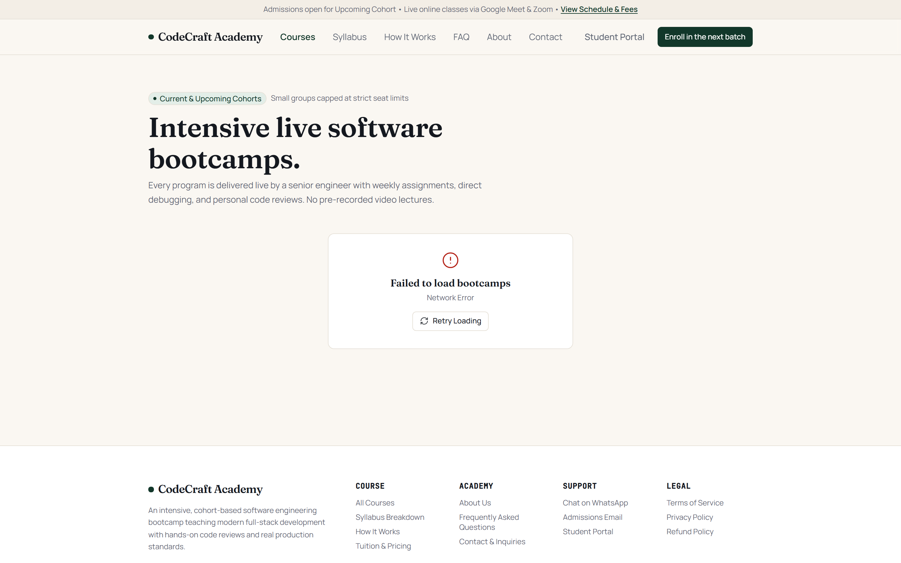
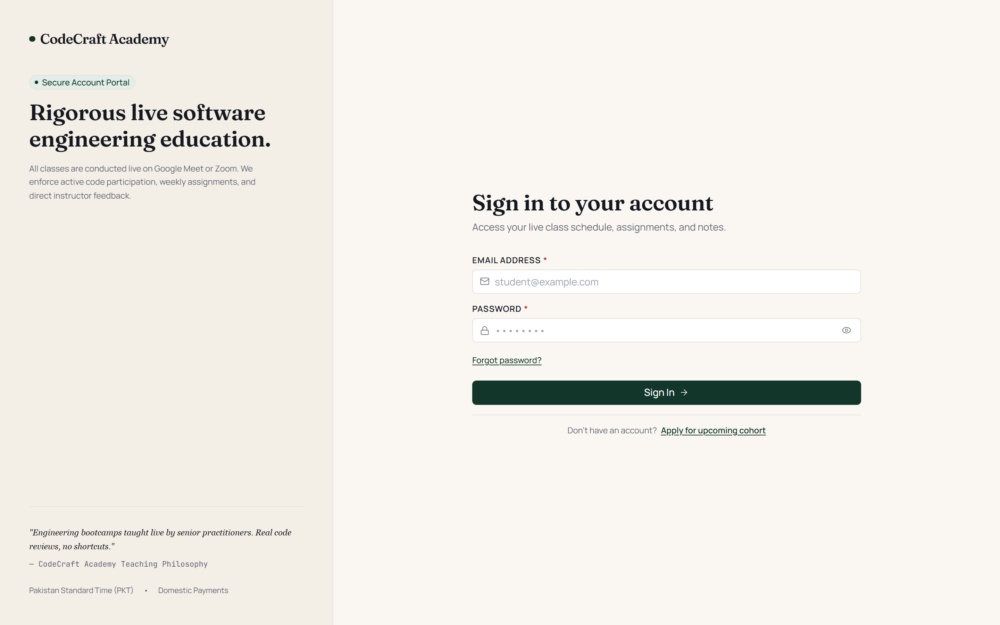
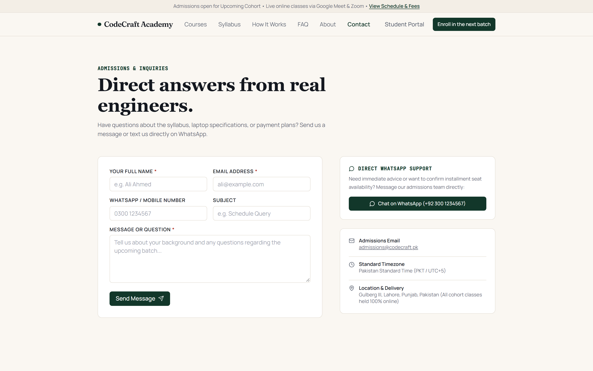

# CodeCraft Academy — Bootcamp Learning Management System (LMS)

[](https://react.dev/)
[](https://nodejs.org/)
[](https://www.mongodb.com/)
[](https://tailwindcss.com/)
[](https://playwright.dev/)

A full-stack, cohort-based Learning Management System purpose-built for intensive live software engineering bootcamps (MERN Full-Stack, Python for Engineers, and Applied AI & Machine Learning).

Unlike generic LMS platforms with bloated video streaming engines, CodeCraft Academy is engineered specifically for **live instructor-led cohorts** conducted via Google Meet and Zoom. It handles the complete lifecycle of a bootcamp: public marketing, student admissions, manual PKR payment verification (JazzCash, EasyPaisa, SadaBiz, Bank Wire), schedule management with time-locked meeting join windows, attendance, lesson materials, auto-graded quizzes, rubric-scored weekly assignments, and student gradebooks.

---

## Visual Showcase

### Public Landing Page & Cohort Information
Hero section featuring live cohort schedules, curriculum breakdowns, and quick admissions entry.


---

### Course Catalog & Detailed Syllabi
Curated engineering tracks with module breakdowns, prerequisites, and transparent tuition details.



---

### Custom Bespoke Design System
Built from the ground up without third-party component libraries. Editorial typography, warm paper tones, and strict accessibility standards.


---

### Admissions, Student Portal & Authentication
Secure single-session authentication, password resets, enrollment wizards, and student dashboards.

<p align="center">
  
  
</p>

---

## Why This LMS?

Traditional LMS software is usually designed for asynchronous courses with pre-recorded video libraries, or assumes international credit card processing via Stripe. 

CodeCraft Academy is built for regional, real-time cohort reality:

1. **Live Instruction Focus (No Video Hosting Overhead)**  
   Classes happen live over Google Meet or Zoom. Meeting links are guarded strictly on the backend: links are never exposed in bulk course endpoints and can only be accessed **15 minutes before class until 30 minutes after completion** by students with active, approved enrollments.

2. **Manual PKR Payment Workflows**  
   Students register and submit transaction references and payment screenshot receipts via JazzCash, EasyPaisa, SadaBiz, or Bank Wire. Admins verify submissions in an operations ledger before granting cohort access.

3. **Academic Integrity & Anti-Cheat Quizzes**  
   Quizzes feature randomized questions, time limits, and strict policy masks. Active student attempts receive questions with answer indexes and explanations stripped away. Detailed keys and scores are released only according to course quiz policy (`immediately`, `after_close`, or `never`).

4. **Direct Cloud Storage (Presigned URLs)**  
   File uploads (receipts, assignment submissions, lesson PDF notes) never transit through the Node.js API server. The backend validates authorization and issues short-lived, presigned storage URLs (15-minute PUT, 1-hour GET), preserving server memory and bandwidth.

5. **Rubric-Based Assignment Grading & Penalties**  
   Weekly engineering assignments support multi-criterion grading rubrics, automated late penalties, and markdown instructor feedback.

---

## Architecture & Monorepo Structure

```text
├── client/                      # React 18 + Vite Single Page Application
│   ├── public/                  # Static assets (Favicons, OG Images, robots.txt)
│   ├── e2e/                     # Playwright End-to-End smoke test suite
│   └── src/
│       ├── components/          # Custom Design System UI Kit (zero external UI dependencies)
│       │   ├── common/          # ErrorBoundary, OfflineNotice, RouteSuspense
│       │   ├── layout/          # PublicLayout, StudentLayout, AdminLayout
│       │   └── ui/              # Button, Input, Table, Modal, ConfirmDialog, Badge
│       ├── config/              # Brand constants (CodeCraft, colors, contacts)
│       ├── content/             # Site copy & curriculum source of truth (site.js)
│       ├── context/             # AuthContext (JWT session state)
│       ├── pages/               # Public marketing, Student portal, Admin workspaces
│       ├── routes/              # Route-level code-splitting (React.lazy + React Router v6)
│       ├── services/            # Axios API layer (auth, courses, quizzes, storage, contact)
│       ├── styles/              # Design tokens (tokens.css) & Tailwind CSS configuration
│       └── utils/               # SEO meta hooks, JSON-LD generator, helpers
│
├── server/                      # Node.js + Express REST API Server
│   └── src/
│       ├── config/              # Environment schema validation (Zod) & MongoDB connection
│       ├── controllers/         # Handlers (auth, enrollment, quiz, assignment, sessions, etc.)
│       ├── middleware/          # protect, authorizeRoles, requireApprovedEnrollment, rate limits
│       ├── models/              # Mongoose schema models (User, Course, Session, Quiz, etc.)
│       ├── routes/              # Modular Express route declarations
│       ├── scripts/             # Database seeding (seed.js) & automated test cleanup
│       ├── services/            # Business services (storageService, emailService, notifications)
│       ├── tests/               # Jest + Supertest + in-memory MongoDB test suites
│       ├── utils/               # ApiError, asyncHandler, response formatting
│       └── validators/          # Fail-fast Zod request schemas
│
├── docs/                        # Specifications & Documentation
│   ├── screenshots/             # Interface screenshots used across documentation
│   ├── DESIGN_SYSTEM.md         # Visual design tokens, typography, and UI rules
│   ├── PROJECT_CONTEXT.md       # Master engineering specifications & invariants
│   └── STORAGE_SETUP.md         # Cloud storage bucket policy configuration guide
│
├── .eslintrc.json               # Code linting rules
├── .prettierrc                  # Code formatting standard
└── package.json                 # Monorepo workspaces and orchestration scripts
```

---

## Tech Stack

### Frontend Client
- **Framework**: React 18 with Vite
- **Styling**: Tailwind CSS + Custom Design System Tokens (`tokens.css`)
- **Typography**: `@fontsource/fraunces` (Editorial Display), `@fontsource/manrope` (Body/UI), `@fontsource/jetbrains-mono` (Code/IDs)
- **Routing**: React Router v6 with chunk code-splitting (`React.lazy` + Suspense)
- **Forms & Validation**: React Hook Form + Zod
- **Icons**: Lucide React

### Backend API Server
- **Runtime**: Node.js 20+ (ES Modules)
- **Web Framework**: Express
- **Database**: MongoDB with Mongoose ODM
- **Authentication**: Stateless JWT with `bcryptjs` (salt rounds: 12)
- **Validation**: Zod schema validation on all incoming request payloads
- **Security**: Helmet headers, CORS policies, Express Rate Limiter, SHA-256 token hashing
- **Object Storage**: Supabase / S3-compatible presigned URL orchestration

---

## Getting Started

### Prerequisites
- **Node.js**: `v20.x` or higher
- **npm**: `v10.x` or higher
- **MongoDB**: Local MongoDB instance (`mongodb://localhost:27017`) or MongoDB Atlas connection URI

---

### 1. Installation

Clone the repository and install dependencies across the monorepo:

```bash
git clone <repo-url>
cd codecraft-lms
npm install
```

---

### 2. Environment Configuration

#### Backend (`server/.env`)
Create a `.env` file inside the `server/` directory:

```ini
PORT=5000
NODE_ENV=development
MONGO_URI=mongodb://localhost:27017/lms_dev
JWT_SECRET=your_jwt_secret_must_be_at_least_32_characters_long_for_security
JWT_EXPIRE=7d
CLIENT_URL=http://localhost:5173

# Initial Seeder Administrator Account
ADMIN_NAME=Admin Instructor
ADMIN_EMAIL=admin@codecraft.academy
ADMIN_PASSWORD=AdminSecurePass123!

# Cloud Storage (Optional for local development, required for uploads)
SUPABASE_URL=
SUPABASE_ANON_KEY=
SUPABASE_SERVICE_ROLE_KEY=
SUPABASE_BUCKET=uploads
```

#### Frontend (`client/.env`)
Create a `.env` file inside the `client/` directory:

```ini
VITE_API_URL=http://localhost:5000/api
VITE_WHATSAPP_NUMBER=+92 300 1234567
```

---

### 3. Database Seeding

Seed the database with the initial instructor account, sample courses, scheduled sessions, and payment configuration:

```bash
npm run seed --prefix server
```

Default instructor credentials created by seed:
- **Email**: `admin@codecraft.academy`
- **Password**: `AdminSecurePass123!`

---

### 4. Running Locally

You can run the backend and frontend concurrently in two separate terminals:

**Terminal 1 — Backend API Server:**
```bash
npm run dev:server
# Server listens on http://localhost:5000
```

**Terminal 2 — Frontend Application:**
```bash
npm run dev:client
# Vite client starts on http://localhost:5173
```

Visit `http://localhost:5173` to explore the website.

---

## Testing & Quality Assurance

### Integration & Unit Tests (Jest + Supertest)
The backend includes automated integration test suites executed with an in-memory MongoDB server (`mongodb-memory-server`), requiring no external database connection:

```bash
npm test --prefix server
```

Test coverage includes:
- Authentication, JWT lifecycle, single-use password resets, and brute-force rate limits
- Enrollment state transitions and manual payment verification flows
- Time-locked live lecture join windows and automated attendance marking
- Anti-cheat quiz attempt masking, question pools, and scoring pipelines
- Assignment rubric evaluations, late penalty deductions, and submission locks
- Storage authorization and presigned URL key formatting

### End-to-End Smoke Tests (Playwright)
Verify core user paths, forms, and responsive mobile/desktop layouts in a headless browser:

```bash
npm run test:e2e
```

### Production Build Verification
Ensure all bundle chunks, lazy-loaded components, and styles compile cleanly:

```bash
npm run build:client
```

---

## Design System Philosophy

The user interface follows strict editorial design guidelines documented in [`docs/DESIGN_SYSTEM.md`](docs/DESIGN_SYSTEM.md):

- **Warm Editorial Color Palette**: Warm paper canvas (`#FAF7F2`), crisp surface cards (`#FFFFFF`), deep obsidian ink (`#14181F`), and forest green accents (`#12372A`).
- **Zero AI-Template Tropes**: No purple/pink saturated gradients, no floating bouncing shapes, no generic chatbot widgets, and no fake testimonials.
- **Accessible & Intentional**: Explicit contrast ratios, native focus rings, visible keyboard navigation traps, accessible dialogs, and real responsive breakpoints tested at 360px, 768px, and 1280px.
- **Zero Window Dialogs**: Destructive actions (deleting courses, resetting submissions) always use custom accessible `ConfirmDialog` modals instead of native browser popups.

---

## Deployment Note

- **Frontend**: Can be built via `npm run build:client` and deployed to any static host (Cloudflare Pages, Netlify, Render, AWS S3/CloudFront, or self-hosted Nginx).
- **Backend**: Containerized or deployed as a Node.js web service on Render, AWS ECS, DigitalOcean, or any standard Linux VPS with reverse proxying (configured for proxy trust and accurate rate limiting).

---

## License

Private & Proprietary — CodeCraft Academy. All rights reserved.
